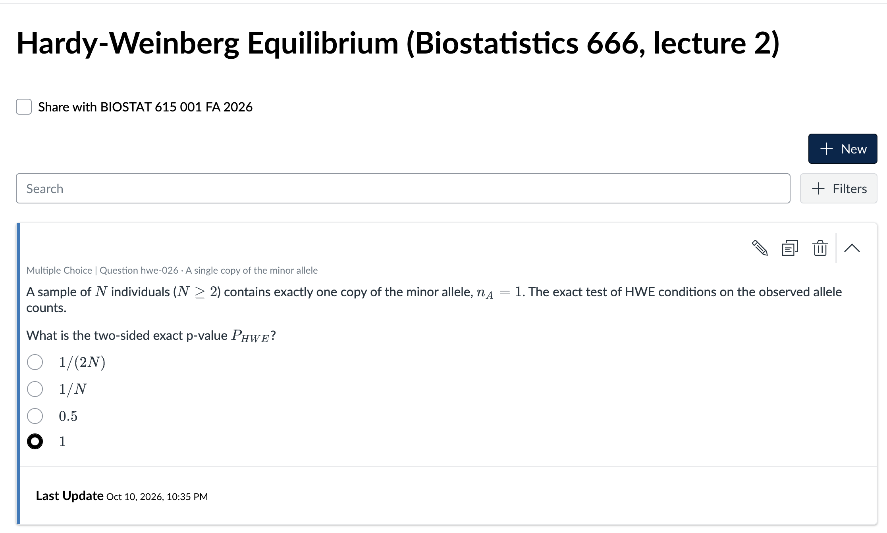

# Example: Hardy-Weinberg equilibrium

One lecture and one request, run with the skill on Claude.ai, ChatGPT and
Gemini. All files are in the repository's
[`examples/hwe/`](https://github.com/hyunminkang/skills/tree/main/examples/hwe)
folder.

## The input

- **Lecture:** *Lecture 02, Hardy Weinberg Equilibrium*, from BIOSTAT 666
  "Models in Human Genetics" by Gonçalo Abecasis: a 36-slide PDF, publicly
  posted at <https://csg.sph.umich.edu/abecasis/class/666.02.pdf>.
- **Request**, given in the chat with the PDF attached:

> /canvas-quizbank draft ~25 Canvas quiz questions from my lecture slides
> for me to review. Include at least one true/false questions, one
> multiple-answer questions, one short answer (numeric answers) questions
> while making most questions as MCQ. Include at least one image, multiple
> mathematical equations, and multiple code blocks (mixture of R and
> python) in the quiz problems.

The skill maps "short answer (numeric answers)" to its `numerical` type.

## What came back

Every platform offered the same two downloads:

| download | what it is |
|---|---|
| `hardy-weinberg.qti.zip` | the file to import into Canvas |
| `hardy-weinberg-source-and-review.zip` | the YAML, the answer-keyed review sheet, the R and Python checks, the figures and a README |

| platform | items | types | verified by running code | code blocks | figures |
|---|---|---|---|---|---|
| Claude.ai (Opus 5.5) | 26 | 23 multiple choice, 1 multiple answers, 1 numerical, 1 true/false | 24 (2 conceptual) | 2 R, 3 Python | 2 |
| ChatGPT | 25 | 20 multiple choice, 2 multiple answers, 2 numerical, 1 true/false | 14 (8 conceptual, 3 R not available) | 3 R, 5 Python | 2 |
| Gemini (Spark, Flash 3.8) | 25 | 20 multiple choice, 2 multiple answers, 2 numerical, 1 true/false | 22 (3 R not available) | 2 R, 3 Python | 2 |

- **Validation:** all three banks pass the skill's validator, and each
  `.qti.zip` matches its YAML.
- **R in the sandbox:**
  - Where the sandbox had no R, the R items are marked `verified: no` and
    listed first in the review sheet.
  - Their checks file is included, so the instructor can run it locally.
- **Smoke test:** Claude.ai also offered the six-item smoke-test bank as a
  third download, because this was the first bank with images and several
  question types.

## In Canvas

This is the Claude.ai bank after import, with the math rendered:

Next: [import a bank into Canvas](import.md), step by step.
