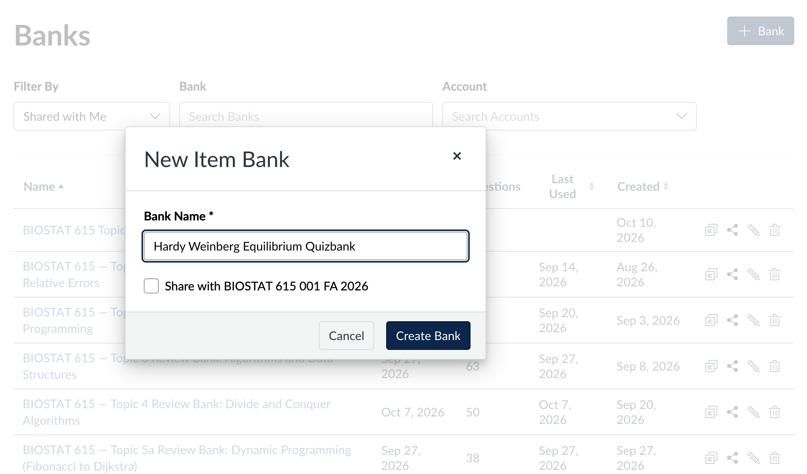
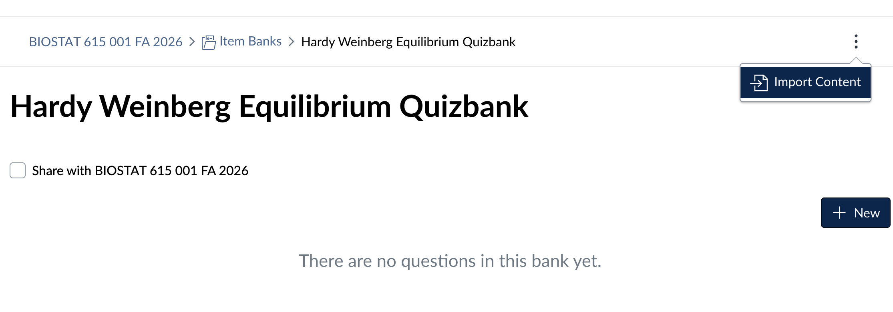

# Importing into Canvas

Import the `<bank>.qti.zip` download. The other zip (`-source-and-review`)
is for you and the agent; Canvas does not use it.

## New Quizzes item bank (recommended)

**1. Create a new item bank.** Open **Item Banks** (from the course
navigation, or **Manage Item Banks** from a New Quiz). Choose **+ Bank**,
name the bank, and choose **Create Bank**. Importing each package into its
own new bank keeps its items together and easy to review.

**2. Import the package.** Open the new bank, choose the **⋮** menu at the
top right, then **Import Content**, and upload `<bank>.qti.zip`. The import
can take a minute.

**3. Review the items.**

- Each item's title starts with its id (here `hwe-026 · A single copy of
  the minor allele`), so you can find it in the review sheet and tell the
  agent which items you kept.
- Math is rendered by Canvas, code appears in monospace blocks, and the
  figures come with the package.

Delete the items that don't fit, using the trash icon on each item. Then
build quizzes from the bank, for example by drawing a set number of random
items per attempt.

## Classic Quizzes

**Course Settings → Import Course Content →** content type **QTI .zip
file**, and upload the package.

- **By default** the items arrive as a quiz.
- **For a named question bank,** ask the agent to package with
  `--mode objectbank`.

## After your review

Give the agent the `-source-and-review.zip` and one of:

- a Canvas export of what is left
- a text file of the remaining item titles, one per line

It marks the kept items `reviewed` and the deleted ones `removed`, then
hands back a fresh pair of downloads. Removed ids are never reused, so
deleted items never come back. See [Using the skill](usage.md#reviewing-in-canvas).

## If something looks wrong

| symptom | what to do |
|---|---|
| "Unsupported content package" | the file was edited or re-zipped; use the `.qti.zip` exactly as downloaded |
| a figure shows as a broken image | ask the agent to package again with `--image-mode inline` |
| an item lacks its explanation after answering | check the quiz's feedback settings; the explanation is the item's general feedback |

The [Canvas details](canvas.md) page lists the package format and which
features have been confirmed in Canvas.
