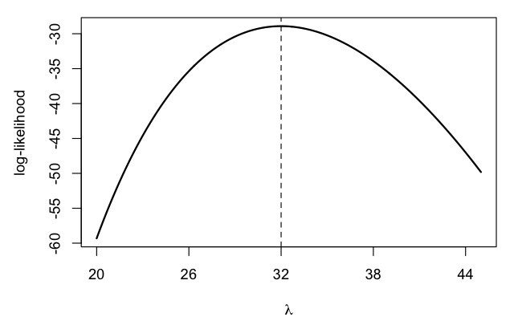

# Example Bank: Function Factories in R

18 items in the package (6 easy, 8 medium, 4 hard; 15 multiple_choice, 1 multiple_answers, 1 numerical, 1 true_false; 18 draft; verified 18 run)

## 1. ff-001 — Two functions from one factory
`closures` `easy` `draft` `verified: run`
*Source: Advanced R (2e) §10.2.1*

```r
power <- function(exp) {
  function(x) x^exp
}
square <- power(2)
cube <- power(3)
c(square(4), cube(2))
```

What does the last line print?

- **A.** `64 8`
- **B.** `16 8` **✅**
- **C.** `16 16`
- **D.** `Error: object 'exp' not found`

> Each call of `power()` creates a new environment holding its own `exp`,
> and the returned function keeps that environment, so `square()` uses
> 2 and `cube()` uses 3: $4^2 = 16$ and $2^3 = 8$. The environment
> survives after `power()` returns, so there is no error, and the two
> functions do not share one `exp`.

## 2. ff-002 — The argument changes before the first call
`lazy-evaluation` `medium` `draft` `verified: run`
*Source: Advanced R (2e) §10.2.3*

```r
power <- function(exp) {
  function(x) x^exp
}
e <- 2
square <- power(e)
e <- 3
square(2)
```

What does the last line print?

- **A.** `4`
- **B.** `9`
- **C.** `8` **✅**
- **D.** `Error: object 'e' not found`

> R evaluates an argument lazily: `exp` is a promise to compute `e`,
> and nothing forces it inside `power()`. The first call `square(2)`
> evaluates it, when `e` is already 3, so the result is $2^3 = 8$.
> Forcing the argument in the factory, `force(exp)`, would fix the value
> at 2 and print 4. The value 9 swaps base and exponent.

## 3. ff-003 — Functions created in a for loop
`lazy-evaluation` `hard` `draft` `verified: run`
*Source: Advanced R (2e) §10.2.3, §10.5*

```r
adders <- list()
for (i in 1:3) {
  adders[[i]] <- function(x) x + i
}
adders[[1]](10)
```

What does the last line print?

- **A.** `13` **✅**
- **B.** `11`
- **C.** `10`
- **D.** `Error: object 'i' not found`

> The loop does not create a new environment per iteration: all three
> functions are created in the global environment and look up `i` there
> when they are called. By then the loop has finished and `i` is 3, so
> the call returns $10 + 3 = 13$. Getting 11 needs a factory that forces
> its argument, so each function has its own enclosing environment with
> its own `i`. Only after `rm(i)` would the call fail.

## 4. ff-004 — Two counters
`state` `medium` `draft` `verified: run`
*Source: Advanced R (2e) §10.2.4*

```r
new_counter <- function() {
  i <- 0
  function() {
    i <<- i + 1
    i
  }
}
a <- new_counter()
b <- new_counter()
c(a(), a(), b(), a())
```

What does the last line print?

- **A.** `1 2 3 4`
- **B.** `1 1 1 1`
- **C.** `1 2 2 3`
- **D.** `1 2 1 3` **✅**

> `<<-` updates `i` in the enclosing environment, so each counter keeps
> its count between calls. `a` and `b` come from separate calls of
> `new_counter()`, so they have separate environments: `a` counts
> 1, 2, 3 while `b` starts its own count at 1. `1 2 3 4` would need one
> shared `i`, and `1 1 1 1` would need a fresh `i` on every call.

## 5. ff-005 — A counter that uses <-
`state` `medium` `draft` `verified: run`
*Source: Advanced R (2e) §10.2.4*

```r
new_counter <- function() {
  i <- 0
  function() {
    i <- i + 1
    i
  }
}
a <- new_counter()
c(a(), a(), a())
```

What does the last line print?

- **A.** `1 1 1` **✅**
- **B.** `1 2 3`
- **C.** `0 0 0`
- **D.** `0 1 2`

> Inside the returned function, `i <- i + 1` reads `i` from the
> enclosing environment (0) but assigns to a new local `i` that
> disappears when the call ends. Every call therefore computes
> $0 + 1 = 1$, and the enclosing `i` stays 0. Only `<<-` writes to the
> enclosing environment and lets the count grow.

## 6. ff-009 — What a returned function keeps alive
`memory` `hard` `draft` `verified: run`
*Source: Advanced R (2e) §10.2.5*

```r
f1 <- function(n) {
  x <- runif(n)
  m <- mean(x)
  function() m
}
f2 <- function(n) {
  x <- runif(n)
  m <- mean(x)
  rm(x)
  function() m
}
g1 <- f1(1e6)
g2 <- f2(1e6)
```

After this runs, how many of the random numbers stay in memory
because `g1` and `g2` exist?

- **A.** none for `g1`, none for `g2`
- **B.** $10^6$ for `g1`, $10^6$ for `g2`
- **C.** $10^6$ for `g1`, none for `g2` **✅**
- **D.** none for `g1`, $10^6$ for `g2`

> A returned function keeps its whole enclosing environment, including
> variables it never uses. `g1` uses only `m`, but its environment
> still holds the $10^6$ doubles in `x` (about 8 MB). `f2` removes `x`
> before returning, so `g2`'s environment holds only `m` and `n`.

## 7. ff-006 — Box-Cox values at x = 4
`box-cox` `medium` `draft` `verified: run`
*Source: Advanced R (2e) §10.4.1*

The Box-Cox transform with parameter $\lambda$ maps $x > 0$ to

$$y_\lambda(x) = \begin{cases} \dfrac{x^\lambda - 1}{\lambda}, & \lambda \neq 0, \\[4pt] \log x, & \lambda = 0. \end{cases}$$

A student tabulates the transform at $x = 4$:

| $\lambda$ | $y_\lambda(4)$ |
|:---:|:---:|
| $1$ | $3$ |
| $0.5$ | $1$ |
| $0$ | $\log 4$ |
| $-1$ | $0.75$ |
| $2$ | $7.5$ |

Exactly one row is wrong. Which one?

- **A.** $\lambda = 1$
- **B.** $\lambda = 0.5$ **✅**
- **C.** $\lambda = -1$
- **D.** $\lambda = 2$

> At $\lambda = 0.5$: $4^{0.5} = 2$, so $y = (2 - 1)/0.5 = 2$, not 1;
> the table forgot to divide by $\lambda$. The other rows check out:
> $(4 - 1)/1 = 3$, $(1/4 - 1)/(-1) = 0.75$ and $(16 - 1)/2 = 7.5$.

## 8. ff-007 — Box-Cox without the special case
`box-cox` `easy` `draft` `verified: run`
*Source: Advanced R (2e) §10.4.1*

```r
boxcox <- function(lambda) {
  function(x) (x^lambda - 1) / lambda
}
boxcox(0)(5)
```

What does the last line print?

- **A.** `1.609438`
- **B.** `0`
- **C.** `Inf`
- **D.** `NaN` **✅**

> With $\lambda = 0$ the formula computes $(5^0 - 1)/0 = 0/0$, which is
> `NaN` in floating point. The transform's value at $\lambda = 0$ is the
> limit $\log 5 \approx 1.609$, which the code never computes; that is
> why the transform needs a separate branch for $\lambda = 0$.

## 9. ff-010 — Maximizing a Poisson log-likelihood
`likelihood` `easy` `draft` `numerical` `verified: run`
*Source: Advanced R (2e) §10.4.3*

The counts $x = (2, 4, 3, 7)$ are modeled as independent
Poisson($\lambda$) draws, with log-likelihood
$\ell(\lambda) = \log(\lambda) \sum_i x_i - n\lambda - \sum_i \log(x_i!)$.

Enter the value of $\lambda$ that maximizes $\ell(\lambda)$.

**Answer:** 4 ± 0.01 ✅

> Setting $\ell'(\lambda) = \sum_i x_i / \lambda - n = 0$ gives
> $\hat\lambda = \bar{x} = 16/4 = 4$.

## 10. ff-011 — A term that does not move the maximum
`likelihood` `medium` `draft` `verified: run`
*Source: Advanced R (2e) §10.4.3*

For counts $x_1, \dots, x_n$ modeled as Poisson($\lambda$), the
log-likelihood is

$$\ell(\lambda) = \log(\lambda) \sum_{i=1}^{n} x_i \;-\; n\lambda \;-\; \sum_{i=1}^{n} \log(x_i!).$$

Which term can be left out of the code without changing the value of
$\lambda$ that maximizes $\ell$?

- **A.** $\log(\lambda) \sum_i x_i$
- **B.** $n\lambda$
- **C.** $\sum_i \log(x_i!)$ **✅**
- **D.** none of the three

> $\sum_i \log(x_i!)$ does not depend on $\lambda$: it shifts the curve
> up or down without moving its peak. The other two terms both depend
> on $\lambda$; without $n\lambda$, for example, $\ell$ increases
> forever and has no maximum.

## 11. ff-012 — Work done once versus on every call
`precomputation` `hard` `draft` `verified: run`
*Source: Advanced R (2e) §10.4.3*

```r
ll1 <- function(x) {
  function(lambda) {
    log(lambda) * sum(x) - length(x) * lambda - sum(lfactorial(x))
  }
}
ll2 <- function(x) {
  s <- sum(x)
  n <- length(x)
  lf <- sum(lfactorial(x))
  function(lambda) log(lambda) * s - n * lambda - lf
}
```

Each factory is called once on $n$ counts, and an optimizer then calls
the returned function $k$ times. What is the total cost of the factory
call and the $k$ calls?

- **A.** `ll1`: $\Theta(n + k)$; `ll2`: $\Theta(kn)$
- **B.** `ll1`: $\Theta(kn)$; `ll2`: $\Theta(kn)$
- **C.** `ll1`: $\Theta(n + k)$; `ll2`: $\Theta(n + k)$
- **D.** `ll1`: $\Theta(kn)$; `ll2`: $\Theta(n + k)$ **✅**

> `ll1`'s returned function recomputes `sum(x)`, `length(x)` and
> `sum(lfactorial(x))` on every call, $\Theta(n)$ each time, so $k$
> calls cost $\Theta(kn)$. `ll2` does the $\Theta(n)$ work once in the
> factory, and each call is then $\Theta(1)$: $\Theta(n + k)$ in total.

## 12. ff-013 — Which returned functions can change
`state` `medium` `draft` `multiple_answers` `verified: run`
*Source: Advanced R (2e) §10.2.4, §10.4.2*

Each factory below is called once (with `x <- 1:10` where it takes an
argument) and returns a function `g` with no arguments. For which
factories can two consecutive calls `g(); g()` return different
values? Select all that apply.

- **A.** `function() { i <- 0; function() { i <<- i + 1; i } }` **✅**
- **B.** `function(x) { force(x); function() mean(sample(x, replace = TRUE)) }` **✅**
- **C.** `function(x) { m <- mean(x); function() m }`
- **D.** `function(x) { force(x); function() max(x) }`

> The first function changes its own state with `<<-`, so it returns
> 1, then 2. The second draws a new bootstrap resample on every call,
> so its mean varies. The third returns a mean computed once in the
> factory, and the fourth recomputes `max(x)` on data that never
> changes, so both return the same value every time.

## 13. ff-014 — Values a bootstrap mean can take
`bootstrap` `medium` `draft` `verified: run`
*Source: Advanced R (2e) §10.4.2*

```r
boot_mean <- function(x) {
  force(x)
  function() mean(sample(x, length(x), replace = TRUE))
}
b <- boot_mean(c(1, 2, 3))
```

Which value can `b()` never return?

- **A.** `1`
- **B.** `2`
- **C.** `2.5` **✅**
- **D.** `3`

> Each call averages three values drawn with replacement from 1, 2 and
> 3, so it returns (sum of three draws)/3 with a whole-number sum from
> 3 to 9. A mean of 2.5 needs a sum of 7.5, which is impossible. Means
> of 1 (1, 1, 1), 2 (e.g. 1, 2, 3) and 3 (3, 3, 3) can all occur.

## 14. ff-015 — How often the model is fitted
`bootstrap` `easy` `draft` `verified: run`
*Source: Advanced R (2e) §10.4.2*

```r
boot_resid <- function(df, formula) {
  fit <- lm(formula, data = df)
  fitted <- unname(fitted(fit))
  resid <- unname(resid(fit))
  function() fitted + sample(resid)
}
gen <- boot_resid(mtcars, mpg ~ wt)
sims <- replicate(1000, gen())
```

How many times does `lm()` run in this code?

- **A.** `1000`
- **B.** `1` **✅**
- **C.** `1001`
- **D.** `0`

> `lm()` runs once, inside the factory call `boot_resid(mtcars, mpg ~ wt)`.
> The returned function only adds a permutation of the stored residuals
> to the stored fitted values, so the 1000 calls made by `replicate()`
> never refit the model. Doing the expensive setup once in the factory
> is the point of this design.

## 15. ff-016 — Reading a log-likelihood curve
`likelihood` `medium` `draft` `verified: run`
*Source: Advanced R (2e) §10.4.3*

The figure shows the Poisson log-likelihood $\ell(\lambda)$ of
$n = 10$ counts; the dashed line marks its maximum.



Which statement about the ten counts must be true?

- **A.** Their median is 32.
- **B.** Their mean is 32. **✅**
- **C.** Their largest value is 32.
- **D.** Their sum is 32.

> The Poisson log-likelihood is maximized at $\hat\lambda = \bar{x}$, so
> the peak at 32 says the mean of the counts is 32 (their sum is
> therefore 320). The curve says nothing definite about the median or
> the largest value; in this sample they are 31.5 and 40.

## 16. ff-017 — Arguments outlive the factory call
`closures` `easy` `draft` `true_false` `verified: run`
*Source: Advanced R (2e) §10.2.1*

True or false: in R, a function returned by a function factory can
still use the factory's arguments after the factory call has
returned.

**Answer:** True ✅

> True. The returned function's enclosing environment is the execution
> environment of the factory call, and R keeps that environment alive
> as long as the returned function exists.

## 17. ff-018 — An empirical CDF as a function
`factories-in-base-r` `easy` `draft` `verified: run`
*Source: Advanced R (2e) §10.3*

`ecdf(x)` returns the empirical distribution function of the data
`x`, $\hat F(t) = \#\{i : x_i \le t\} / n$, as an R function.

```r
Fn <- ecdf(c(3, 1, 4, 1, 5))
Fn(2)
```

What does the last line print?

- **A.** `0.2`
- **B.** `0.4` **✅**
- **C.** `0.5`
- **D.** `2`

> Two of the five values (both 1s) are at most 2, so
> $\hat F(2) = 2/5 = 0.4$. 0.2 counts the distinct value 1 once, and 2
> is the count without dividing by $n$.

## 18. ff-019 — A named list of power functions
`factories-and-functionals` `hard` `draft` `verified: run`
*Source: Advanced R (2e) §10.5*

`lapply()` keeps the names of its input in the list it returns.

```r
power <- function(exp) {
  force(exp)
  function(x) x^exp
}
funs <- lapply(c(square = 2, cube = 3, root = 0.5), power)
funs$root(64) + funs$cube(2)
```

What does the last line print?

- **A.** `16` **✅**
- **B.** `72`
- **C.** `12`
- **D.** `4104`

> `funs` holds three functions with exponents 2, 3 and 0.5, named
> `square`, `cube` and `root`. `funs$root(64)` is $64^{0.5} = 8$ and
> `funs$cube(2)` is $2^3 = 8$, so the sum is 16. 72 uses $64 + 8$
> (no root), 12 uses $64^{0.5} + 2^2$, and 4104 uses $64^2 + 2^3$.
