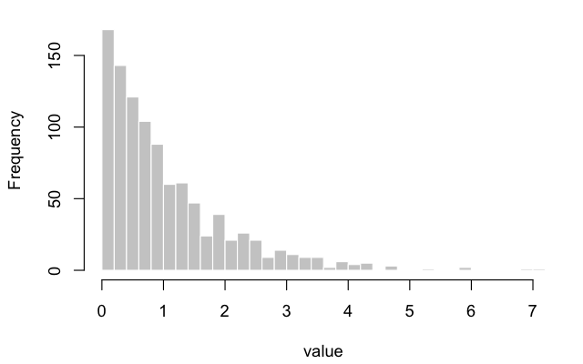

# canvas-quizbank smoke test

6 items in the package (6 easy; 2 multiple_choice, 1 multiple_answers, 2 numerical, 1 true_false; 6 draft; verified 6 run)

## 1. st-001 — Multiple choice: math and code
`inline-display-math-code` `easy` `draft` `verified: run`
*Source: smoke test*

The sample variance of $x_1, \dots, x_n$ is

$$s^2 = \frac{1}{n - 1} \sum_{i=1}^{n} \left(x_i - \overline{x}\right)^2 .$$

```r
x <- c(2, 4, 9)
var(x)
```

```python
import numpy as np
x = np.array([2, 4, 9])
print(np.var(x, ddof=1))
```

Both snippets compute $s^2$. What value do they print?

- **A.** $13$ **✅**
- **B.** $\frac{26}{3}$
- **C.** $5$
- **D.** $39$

> $\overline{x} = 5$, the squared deviations are $9, 1, 16$, and
> $26 / (3 - 1) = 13$. $26/3$ divides by $n$ instead of $n - 1$.

## 2. st-002 — Multiple answers: math in choices
`multiple-answers` `easy` `draft` `multiple_answers` `verified: run`
*Source: smoke test*

For data $x_1, \dots, x_n$ with standard deviation $s_x$ and constants
$a \ne 0$ and $b$, which statements are true? Select all that apply.

- **A.** The standard deviation of $a x_i + b$ is $|a|\, s_x$. **✅**
- **B.** The variance of $a x_i$ is $a^2 s_x^2$. **✅**
- **C.** The standard deviation of $x_i + b$ is $s_x + b$.
- **D.** The variance of $a x_i$ is $a\, s_x^2$.

> Adding $b$ shifts every value and the mean together, so spread is
> unchanged; multiplying by $a$ scales deviations by $|a|$ and squared
> deviations by $a^2$.

## 3. st-003 — Numerical: value with a tolerance
`numerical-tolerance` `easy` `draft` `numerical` `verified: run`
*Source: smoke test*

The data $2, 4, 9$ have sample variance $13$. Enter the standard error
of the mean, $s / \sqrt{n}$, to three decimal places.

**Answer:** 2.082 ± 0.001 ✅

> $s / \sqrt{n} = \sqrt{13} / \sqrt{3} = \sqrt{13/3} \approx 2.082$.

## 4. st-004 — Numerical: a range
`numerical-range` `easy` `draft` `numerical` `verified: run`
*Source: smoke test*

For $Z \sim N(0, 1)$, enter $\Pr(Z \le 1.96)$ to two or three decimal
places.

**Answer:** any value in [0.97, 0.98] ✅

> $\Pr(Z \le 1.96) = 0.975$, which is why $\pm 1.96$ bounds a 95%
> normal interval.

## 5. st-005 — True/false with code
`true-false` `easy` `draft` `true_false` `verified: run`
*Source: smoke test*

True or false: in double-precision arithmetic, `0.1 + 0.2 == 0.3`
evaluates to `TRUE`.

**Answer:** False ✅

> False. Neither 0.1 nor 0.2 is exact in binary, and their rounded sum
> differs from the rounded 0.3 by about $5.6 \times 10^{-17}$.

## 6. st-006 — Multiple choice: a figure and a table
`image-table` `easy` `draft` `verified: run`
*Source: smoke test*

The histogram shows 1,000 draws from one distribution.



| summary | value |
|:--|--:|
| mean | $\overline{x}$ |
| median | $m$ |

Which relation between the two summaries does the shape suggest?

- **A.** $\overline{x} > m$ **✅**
- **B.** $\overline{x} < m$
- **C.** $\overline{x} = m$
- **D.** $\overline{x} = 2m$

> A long right tail pulls the mean toward the large values, while the
> median stays with the bulk of the data near 0, so $\overline{x} > m$.
